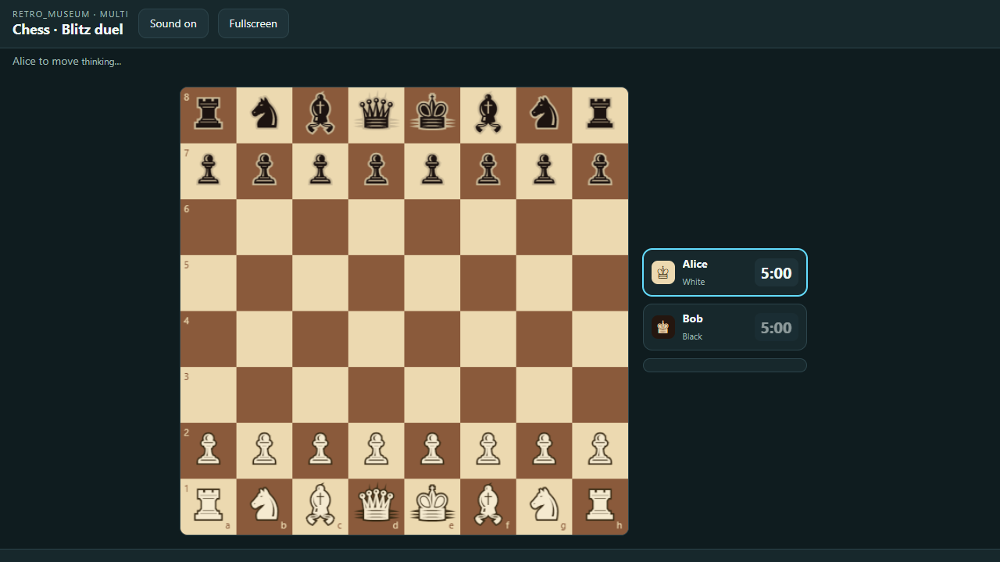
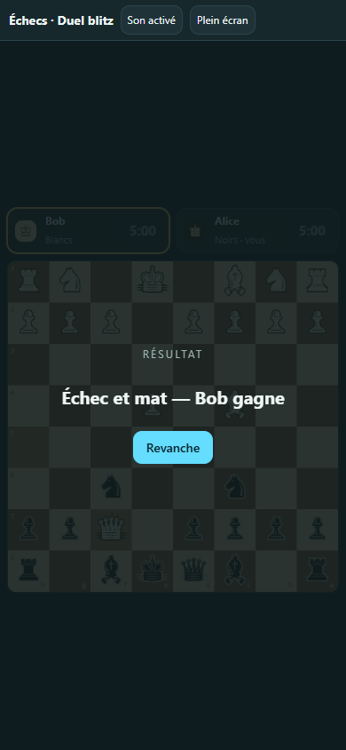

[▶ Play online — no installation](https://play.retro-museum.net/g/chess)

# Chess · Blitz duel

A two-player chess duel with blitz clocks on the shared screen. Each phone shows the board from its player's side; tap a piece, tap a square.

An independent, open-source Manaty game. English, French and Tagalog. No Retro Museum installation or account is required to run it.

## Play on your own server

```sh
npm ci
npm run build
npm start
```

Open [localhost:4311](http://localhost:4311), click **Play now**, and scan the displayed QR with each phone. On Wi-Fi, browse to the computer's reachable address (such as `http://192.168.1.10:4311`) so the QR encodes it. `PORT` and `DATA_DIR` are configurable.

Supported moves and automatic draw rules run on the server: castling, en passant, promotion, checkmate, stalemate, the fifty-move rule, threefold repetition and insufficient material. Each player gets a blitz clock that starts when play begins. Colours are drawn at random; the room organiser can start, pause and end the game, and players can rematch.

## Development

```sh
npm run build
npm test
```

The engine's move generator is verified with standard perft node counts (start position, Kiwipete and promotion/rook-edge positions). The runtime and room transport come from the [Retro Museum SDK](https://github.com/manaty/retro-museum-sdk). This repository owns its engine, interface, compiled package and tests.

## Licence

Original code and assets: Manaty, MIT. This project is an independent game implementation and is not affiliated with any commercial game publisher.

## Release quality

Version 1.0.1 fixes host completion for matches without a winner, adds persistent sound controls and refreshes labels when language changes. Tested with the packaged QuickJS engine, real host transport and a browser display plus two controllers (390 × 844 and 1280 × 720). Actual older TVs and eight simultaneous Sketch phones have not been device-tested.





See the [game acceptance checklist](https://github.com/manaty/retro-museum-sdk/blob/main/GAME-QUALITY.md).

This is casual chess: threefold repetition and fifty moves trigger an automatic draw. Draw claims, draw offers and resignation are not implemented. Basic insufficient-material cases are detected; not every possible blocked dead position or impossible-mate timeout configuration is recognized. It is not a complete FIDE tournament implementation. Rule reference: [FIDE Laws, articles 6.9 and 9](https://handbook.fide.com/chapter/E012023).
